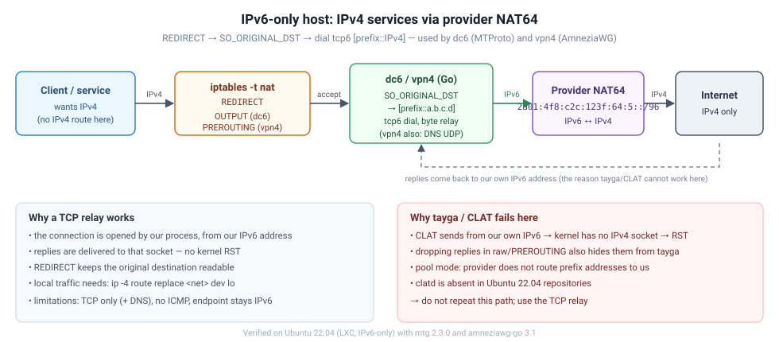

# nat64-bridge

[](LICENSE)

**IPv4 services on an IPv6-only server through the provider's NAT64.**
Technique: `REDIRECT → SO_ORIGINAL_DST → connect over IPv6 to <prefix>::<IPv4>`.

[Русский](README.md) · [Recipe](docs/en/recipe.md) · [AmneziaWG 3.1](docs/en/amneziawg.md) · [Agent prompt](prompts/PROMPT.en.md) · [CI](ci/README.md)



---

## The problem

The host has no IPv4 route (`ip -4 route` is empty) but the provider runs DNS64/NAT64. Services still
need IPv4 egress: the Telegram MTProto proxy dials IPv4 datacenter addresses, AmneziaWG clients expect
ordinary IPv4 internet. A classic CLAT (`tayga`, `clatd`, `jool`) does not work on such a host — replies
arrive at the local IPv6 address and the kernel answers with `RST`.

## The solution

The connection is opened by **our own process** from our own IPv6 address, so replies are delivered to
its socket:

```
iptables -t nat REDIRECT  →  local Go relay  →  SO_ORIGINAL_DST  →  dial tcp6 [prefix::IPv4]:port
                                        ▼
                              provider NAT64  →  IPv4 internet
```

Two ready-to-run services:

| Service | Purpose | Ports |
|---|---|---|
| **`dc6`** | IPv4→IPv6 bridge for `mtg` (Telegram MTProto proxy) | listens on `127.0.0.1:19191` |
| **`vpn4`** | IPv4 for AmneziaWG clients (plus DNS over NAT64) | `0.0.0.0:19192/tcp`, `0.0.0.0:5353/udp` |

## Quick start

```bash
# 1. Check that the technique applies (finds the prefix and tests TCP through NAT64)
sudo ./scripts/nat64-probe.sh

# 2. Build a bridge (Go 1.24+, static binary)
CGO_ENABLED=0 go build -trimpath -ldflags "-s -w" -o dc6  src/dc6/main.go

# 3. Install (MTProto variant)
sudo ./scripts/install-dc6.sh 2a01:4f8:c2c:123f:64:5 cloudflare.com

# 4. Acceptance
sudo ./scripts/verify.sh
```

For AmneziaWG use `scripts/install-vpn4.sh` and the client config from the [recipe](docs/en/recipe.md).

## Contents

| Path | What it is |
|---|---|
| `docs/ru`, `docs/en` | full recipe, AmneziaWG 3.1 build notes, MTProto details |
| `prompts/` | ready-to-use agent prompts (RU / EN) to reproduce the setup elsewhere |
| `src/dc6`, `src/vpn4` | bridge sources (Go, stdlib + `syscall` only) |
| `scripts/` | `nat64-probe.sh`, `install-dc6.sh`, `install-vpn4.sh`, `verify.sh` |
| `assets/diagram.svg` | the diagram |

## Limitations

- **TCP works fully**; UDP only for DNS (53) in the `vpn4` variant. QUIC and other UDP do not pass
  (browsers fall back to TCP).
- **ICMP/ping does not work.**
- **The endpoint stays IPv6** — the client must have IPv6 connectivity.
- The egress IPv4 address is the provider's NAT64 address.

## Verified on

Ubuntu 22.04 inside LXC (Proxmox kernel 6.8.12-pve), IPv6-only `2a0c:…`, NAT64
`2a01:4f8:c2c:123f:64:5::/96`: `mtg` 2.3.0 reaching Telegram DCs through the bridge, and
`amneziawg-go` 3.1 delivering IPv4 inside the tunnel (DNS and HTTPS through NAT64).

## License

MIT — see [LICENSE](LICENSE).
