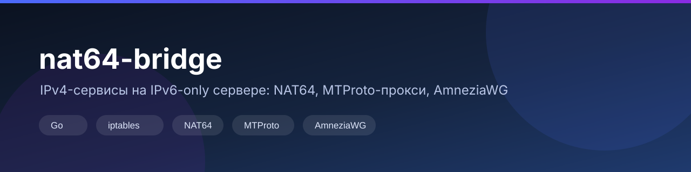
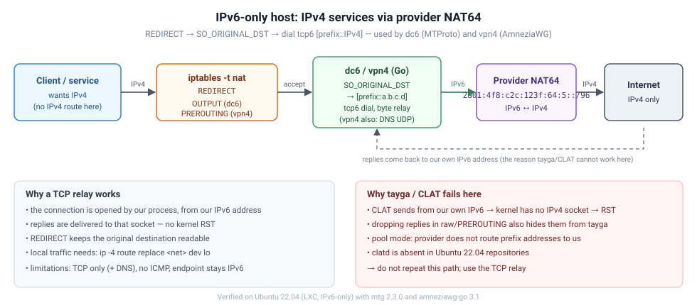

<div align="center">
  
</div>

# nat64-bridge

**RU** · [English](#english)

[](https://github.com/rukazax)
[](#)
[](#)
[](#)
[](LICENSE)

> **IPv4-сервисы на IPv6-only сервере через NAT64 провайдера.**
> Приём: `REDIRECT → SO_ORIGINAL_DST → соединение по IPv6 на <prefix>::<IPv4>`.

[Рецепт](docs/ru/recipe.md) · [AmneziaWG 3.1](docs/ru/amneziawg.md) · [Промт для агента](prompts/PROMPT.ru.md) · [CI](ci/README.md)

| 🧭 Раздел | О чём |
| --- | --- |
| [Проблема](#проблема) | Сервер без IPv4-маршрута, а сервисам нужен IPv4-выход |
| [Решение](#решение) | REDIRECT → SO_ORIGINAL_DST → IPv6-диал через NAT64 |
| [Быстрый старт](#быстрый-старт) | Probe → сборка → установка → приёмка |
| [Что внутри](#что-внутри) | Карта каталогов репозитория |
| [Ограничения](#ограничения) | TCP да, UDP частично, ICMP нет |
| [Проверено на](#проверено-на) | Стенд: Ubuntu 22.04 в LXC, NAT64-префикс провайдера |
| [Лицензия](#лицензия) | MIT |
| [English](#english) | English version |



---

## Проблема

Сервер без IPv4-маршрута (`ip -4 route` пуст), но у провайдера есть DNS64/NAT64. Сервисам нужен
IPv4-выход: MTProto-прокси Telegram ходит на IPv4-адреса дата-центров, клиентам AmneziaWG нужен
обычный IPv4-интернет. Классический CLAT (`tayga`, `clatd`, `jool`) на таком хосте не работает —
ответы приходят на локальный IPv6, ядро отвечает `RST`.

## Решение

Соединение открывает **наш собственный процесс** с нашего IPv6-адреса, поэтому ответы доставляются
его сокету:

```
iptables -t nat REDIRECT  →  локальный Go-релей  →  SO_ORIGINAL_DST  →  dial tcp6 [prefix::IPv4]:port
                                            ▼
                                  NAT64 провайдера  →  IPv4-интернет
```

Два готовых сервиса:

| Сервис | Назначение | Порты |
|---|---|---|
| **`dc6`** | IPv4→IPv6 мост для `mtg` (MTProto-прокси Telegram) | слушает `127.0.0.1:19191` |
| **`vpn4`** | IPv4 для клиентов AmneziaWG (+ DNS через NAT64) | `0.0.0.0:19192/tcp`, `0.0.0.0:5353/udp` |

## Быстрый старт

```bash
# 1. Убедиться, что приём применим (найдёт префикс и проверит TCP через NAT64)
sudo ./scripts/nat64-probe.sh

# 2. Собрать мост (Go 1.24+, статический бинарь)
CGO_ENABLED=0 go build -trimpath -ldflags "-s -w" -o dc6  src/dc6/main.go

# 3. Поставить (вариант MTProto)
sudo ./scripts/install-dc6.sh 2a01:4f8:c2c:123f:64:5 cloudflare.com

# 4. Приёмка
sudo ./scripts/verify.sh
```

Для AmneziaWG — `scripts/install-vpn4.sh` и клиентский конфиг из [рецепта](docs/ru/recipe.md).

## Что внутри

| Путь | Содержание |
|---|---|
| `docs/ru`, `docs/en` | полный рецепт, сборка AmneziaWG 3.1, детали MTProto |
| `prompts/` | готовые промты для агента (RU / EN) — воспроизвести приём на другом сервере |
| `src/dc6`, `src/vpn4` | исходники мостов (Go, только stdlib + `syscall`) |
| `scripts/` | `nat64-probe.sh`, `install-dc6.sh`, `install-vpn4.sh`, `verify.sh` |
| `assets/diagram.svg` | схема работы |

## Ограничения

- **TCP работает полностью**; UDP — только DNS (53) в варианте `vpn4`. QUIC и прочий UDP не проходят
  (браузеры откатываются на TCP).
- **ICMP/ping не работает.**
- **Endpoint остаётся IPv6** — клиенту нужна IPv6-сеть.
- Выходной IPv4 — адрес NAT64-провайдера.

## Проверено на

Ubuntu 22.04 в LXC (ядро Proxmox 6.8.12-pve), IPv6-only `2a0c:…`, NAT64 `2a01:4f8:c2c:123f:64:5::/96`:
`mtg` 2.3.0 + Telegram DC через мост, `amneziawg-go` 3.1 + IPv4 в туннеле (DNS и HTTPS через NAT64).

## Лицензия

MIT — см. [LICENSE](LICENSE).

## English

> **IPv4 services on an IPv6-only server through the provider's NAT64.**
> Inbound: `REDIRECT → SO_ORIGINAL_DST → IPv6 connection to <prefix>::<IPv4>`.

[Recipe](docs/ru/recipe.md) · [AmneziaWG 3.1](docs/ru/amneziawg.md) · [Agent prompt](prompts/PROMPT.ru.md) · [CI](ci/README.md)

### The problem

The server has no IPv4 route (`ip -4 route` is empty), but the provider offers DNS64/NAT64. Services
still need an IPv4 exit: the Telegram MTProto proxy reaches IPv4 addresses of data centers, and
AmneziaWG clients need the ordinary IPv4 internet. Classic CLAT (`tayga`, `clatd`, `jool`) does not
work on such a host — replies arrive on the local IPv6 address and the kernel answers with `RST`.

### The solution

The connection is opened by **our own process** from our own IPv6 address, so replies are delivered
to its socket:

```
iptables -t nat REDIRECT  →  local Go relay  →  SO_ORIGINAL_DST  →  dial tcp6 [prefix::IPv4]:port
                                            ▼
                              provider NAT64  →  IPv4 internet
```

Two ready-made services:

| Service | Purpose | Ports |
|---|---|---|
| **`dc6`** | IPv4→IPv6 bridge for `mtg` (Telegram MTProto proxy) | listens on `127.0.0.1:19191` |
| **`vpn4`** | IPv4 for AmneziaWG clients (+ DNS via NAT64) | `0.0.0.0:19192/tcp`, `0.0.0.0:5353/udp` |

### Quick start

```bash
# 1. Make sure the trick is applicable (finds the prefix and tests TCP via NAT64)
sudo ./scripts/nat64-probe.sh

# 2. Build the bridge (Go 1.24+, static binary)
CGO_ENABLED=0 go build -trimpath -ldflags "-s -w" -o dc6  src/dc6/main.go

# 3. Install (MTProto variant)
sudo ./scripts/install-dc6.sh 2a01:4f8:c2c:123f:64:5 cloudflare.com

# 4. Acceptance
sudo ./scripts/verify.sh
```

For AmneziaWG — `scripts/install-vpn4.sh` and the client config from the [recipe](docs/ru/recipe.md).

### What's inside

| Path | Contents |
|---|---|
| `docs/ru`, `docs/en` | the full recipe, AmneziaWG 3.1 build, MTProto details |
| `prompts/` | ready-made agent prompts (RU / EN) — reproduce the trick on another server |
| `src/dc6`, `src/vpn4` | bridge sources (Go, stdlib + `syscall` only) |
| `scripts/` | `nat64-probe.sh`, `install-dc6.sh`, `install-vpn4.sh`, `verify.sh` |
| `assets/diagram.svg` | the diagram |

### Limitations

- **TCP works fully**; UDP — only DNS (53) in the `vpn4` variant. QUIC and other UDP do not pass
  (browsers fall back to TCP).
- **ICMP/ping does not work.**
- **The endpoint stays IPv6** — the client needs an IPv6 network.
- The outbound IPv4 is the NAT64 provider's address.

### Tested on

Ubuntu 22.04 in LXC (Proxmox 6.8.12-pve kernel), IPv6-only `2a0c:…`, NAT64 `2a01:4f8:c2c:123f:64:5::/96`:
`mtg` 2.3.0 + a Telegram DC through the bridge, `amneziawg-go` 3.1 + IPv4 inside the tunnel (DNS and
HTTPS via NAT64).

### License

MIT — see [LICENSE](LICENSE).

---

#nat64 #ipv6-only #ipv4 #mtproto #telegram-proxy #amneziawg #golang #iptables #netfilter #so-original-dst #vpn
